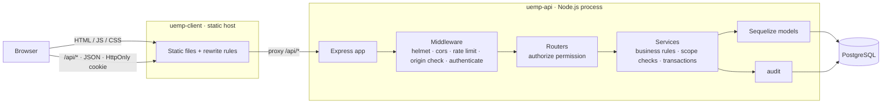
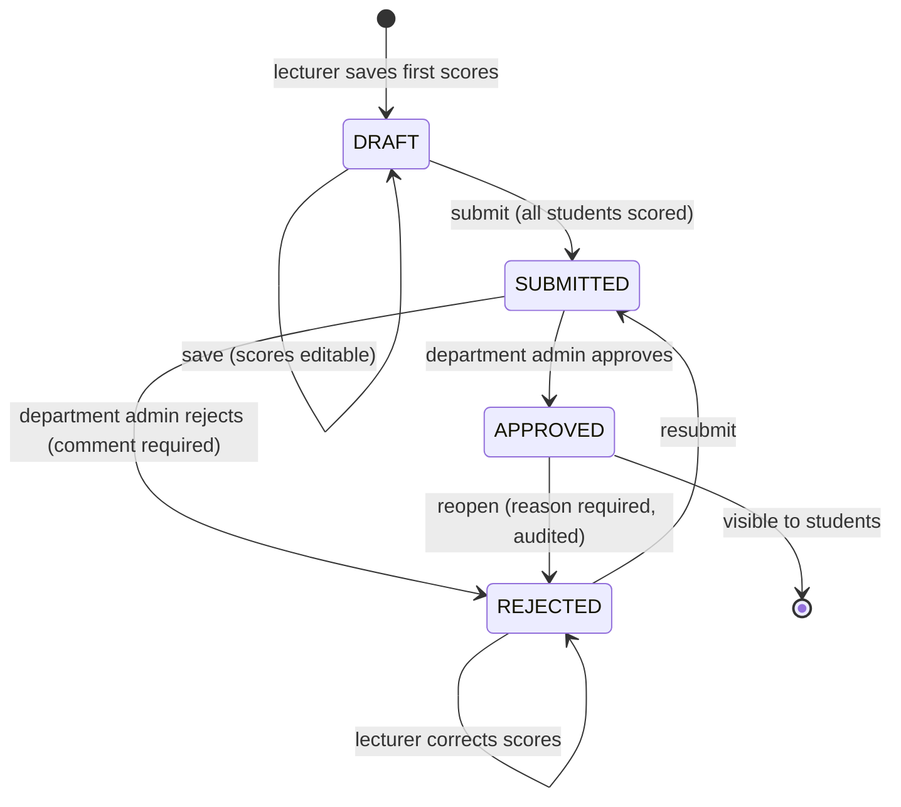

# Architecture

## Overview

UEMP is two independently developed and deployed applications, each in its own repository:

| Repository | What it is | Deployed as |
|---|---|---|
| **uemp-api** (this repo) | REST API: Express 5, TypeScript, Sequelize, PostgreSQL | Node web service + PostgreSQL |
| **uemp-client** | Single-page app: React 19, TypeScript, Tailwind CSS v4, Vite | Static site |



**Why separate apps.** The client and the API have different runtimes, dependencies, build pipelines and
hosting needs: a static CDN versus a Node process with a database. Keeping them apart gives each its own
release cycle and history, and keeps the API usable by other clients later, such as a mobile app. The
contract between them is the HTTP API documented in [API.md](API.md).

**Same origin without coupling.** The static host rewrites `/api/*` to the API service (in development,
the Vite dev server does the same). To the browser, the UI and the API share one origin, so the session cookie
can stay `HttpOnly` and `SameSite=Lax` with no cross-site cookie or CORS setup. The API stays
free of any frontend code.

**Inside the API**, the server is a **modular monolith**: one deployable unit organised by business domain.
For a system of this size it gives one deploy, one database transaction boundary and no network hops between
modules, while keeping the boundaries clean enough to split later if needed.

## Repository layout

```
uemp-api/
├─ src/
│  ├─ app.ts                 builds the Express app (no listen, so tests can import it)
│  ├─ server.ts              process entry point and graceful shutdown
│  ├─ routes.ts              mounts module routers under /api/v1
│  ├─ config/                env (Zod-validated at boot) and academic policy constants
│  ├─ domain/                pure logic with no I/O: enums, grading and GPA
│  ├─ rbac/                  permission matrix and scope helpers
│  ├─ middleware/            authenticate, authorize, originCheck, rateLimit, errorHandler
│  ├─ models/                Sequelize models and associations
│  ├─ modules/<domain>/      *.routes.ts → *.service.ts (+ *.schemas.ts)
│  ├─ lib/                   errors, logger, audit, pagination, csv, password, tokens
│  └─ db/                    sequelize instance, Umzug migrator, migrations, seeders, CLI
├─ tests/                    Vitest + Supertest against a real PostgreSQL test DB
├─ docs/                     this documentation
└─ render.yaml               deployment blueprint (API + database)

uemp-client/
├─ src/
│  ├─ app/                   router, route guards, error boundary
│  ├─ components/ui|layout   design-system primitives and the app shell
│  ├─ features/<area>/       pages by role: auth, student, lecturer, admin, shared
│  └─ hooks/ lib/ types/     auth hooks, API client, query client, API response types
└─ render.yaml               deployment blueprint (static site, /api proxy, security headers)
```

## Backend request lifecycle

1. **Global middleware**: request ID and structured logging (pino), Helmet security headers and CSP,
   CORS allow-list, JSON body limit, rate limiting, and an Origin check on unsafe methods (CSRF defence).
2. **`authenticate`** resolves the session cookie to a user, checking expiry, revocation and account
   status, and attaches `req.auth`.
3. **`authorize('permission')`**, declared on each route, checks the role → permission matrix.
4. **Route handler**: parses input with a Zod schema, builds an `Actor` (id, role, departmentId, ip)
   and calls one service function. Handlers contain no business logic.
5. **Service** applies scope checks and business rules, runs writes in a **transaction**, and writes the
   **audit record in the same transaction**.
6. Errors are thrown as typed `AppError`s (`NotFound`, `Forbidden`, `BusinessRule`…). The central
   `errorHandler` maps them, and Zod and Sequelize errors, to a consistent JSON envelope.

Express 5 forwards rejected promises from async handlers to the error handler, so there are no
`try/catch` wrappers in routes.

### Why these choices
| Choice | Reason |
|---|---|
| Sequelize + explicit migrations (no `sync()`) | Schema changes are versioned, reviewable and reversible. Database constraints are written by hand, so they are exact. |
| Zod at every boundary (env, request bodies, query strings) | One schema gives both runtime validation and the static type, with no drift between them. |
| Services take an `Actor`, not `req` | Business logic is testable and reusable from scripts, with no HTTP coupling. |
| Pure `domain/grading.ts` | GPA and grading rules are unit-tested without a database. |
| Row locks for registration and result state changes | Prevents double-submit races (two tabs, double clicks) beyond what unique indexes can express. |

## Result workflow (state machine)



- Only `DRAFT` and `REJECTED` sheets accept score changes.
- On approval, grade and grade point are **frozen** onto each entry. Students only ever read `APPROVED` sheets.
- Every transition writes an audit entry. Score edits record a per-student before/after diff.

## Frontend architecture

| Concern | Approach |
|---|---|
| Routing | React Router 7 data router. Each role has its own area (`/student`, `/lecturer`, `/department`, `/admin`) wrapped in `RequireRole` and the shared `AppShell`. Every page is **lazy-loaded**, so a student never downloads admin code. |
| Server state | TanStack Query: caching, background refresh, invalidation after mutations, and a global 401 handler that returns the user to login. There is no global client-state store because none is needed. |
| Forms | React Hook Form + Zod. Server-side field errors (422) are mapped back onto the matching inputs. |
| Authorisation in UI | Navigation and actions are driven by the user's role and by `capabilities` that the API returns (e.g. `capabilities.canReview` on a result sheet), so the UI never re-implements policy. The API remains the enforcement point. |
| Design system | Small in-house primitives in `components/ui` (Button, Field, Table, Modal, Badge…) on Tailwind v4 tokens. Accessible by default: labels, `aria-*` and a native `<dialog>`. |
| Shared admin pages | Dept Admin and Super Admin use the same pages. The API scopes the data, and the UI only adds filters such as "department" for the Super Admin. |
| Printing | Registration slips, result statements and score sheets use print stylesheets (`.no-print`, `.print-area`). |

## Testing strategy

| Layer | Tooling | What is covered |
|---|---|---|
| Domain | Vitest | grading boundaries, GPA/CGPA, class of degree, grade-scale validation |
| API integration | Vitest + Supertest + real PostgreSQL | auth and session revocation, the RBAC matrix for every role, department scoping, all four workflows end to end, every business rule, audit trail |
| Client | Vitest + Testing Library | API client error mapping, UI primitives, result-sheet review actions per capability |

Integration tests run against a real database rather than mocks, because most of the important
guarantees (constraints, locks, transactions) live there.

## Operational concerns

- **Configuration** is validated at startup, so the process refuses to boot with a bad `DATABASE_URL`.
- **Logging** is structured JSON with request IDs; secrets and cookies are redacted.
- **Graceful shutdown**: on SIGTERM the server stops accepting connections, finishes in-flight requests
  and closes the DB pool.
- **Health check**: `GET /api/health`.
- **Deploys** run `migrate` before start. The seed only runs against an empty database.
- **Security headers for the UI** (CSP, frame denial, nosniff) are set by the static host (`uemp-client/render.yaml`). Helmet sets them for the API.

## Scaling path (not needed for this scope)
- Sessions are in PostgreSQL; move them to Redis if request volume makes the per-request lookup significant.
- Heavy reports could be served from a read replica or materialised views.
- Bulk result upload (CSV) and email notifications on approval/rejection would fit as new modules.
