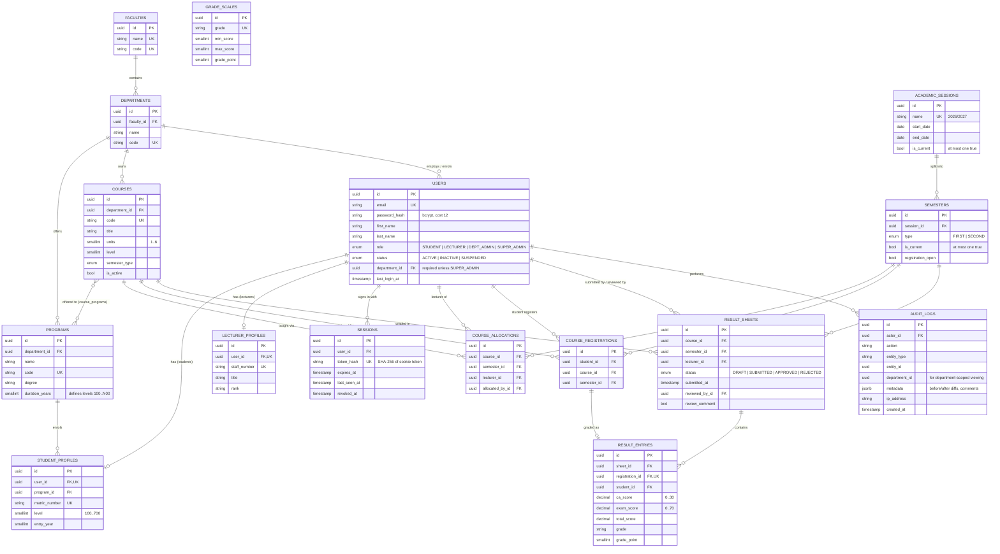

# Database Design

PostgreSQL 14+, managed through **Sequelize 6** models with versioned **Umzug** migrations
(`src/db/migrations`). The schema is normalised (3NF) and every rule that *can* live in the
database does: foreign keys, unique indexes, `CHECK` constraints and partial unique indexes. The
application enforces the same rules with friendlier messages, so the database is the final safety net
rather than the only check.

## Entity–relationship diagram



## Key relationships and why

| Relationship | Design | Reason |
|---|---|---|
| User → Student/Lecturer profile | 1 : 0..1 tables, not columns on `users` | Role-specific fields stay out of the core identity table; `users` stays small and uniform for authentication. |
| Course ↔ Programme | Many-to-many via `course_programs` | A course is *owned* by one department but can be *offered* to several programmes, e.g. MTH101 is owned by Mathematics and taken by Computer Science and Engineering students. Business rule #1 (eligibility) is answered by this join. |
| Course allocation | Unique `(course_id, semester_id)` | Exactly one lecturer is accountable for a course's results in a given semester. |
| Result sheet | Unique `(course_id, semester_id)` | The **sheet** is the unit of submission and approval; its **entries** hold per-student scores. This gives one clean state machine per course instead of per-row statuses. |
| Result entry → registration | Unique `registration_id` FK | A result can only exist for a real registration, so a lecturer cannot grade a student who isn't registered. |
| Student department | `users.department_id` plus the programme's department | `users.department_id` drives administrative scoping for every role. The service layer verifies that a student's programme belongs to their department. |

## Constraints enforced by PostgreSQL

| Constraint | Business rule it backs |
|---|---|
| `course_registrations_no_duplicates` UNIQUE `(student_id, course_id, semester_id)` | #2: no duplicate registration in a semester |
| `result_sheets_no_self_review_chk` CHECK `reviewed_by_id <> lecturer_id` | Lecturers cannot approve their own results |
| `result_entries_scores_chk` CHECK CA 0–30, exam 0–70, total 0–100 | Score validity |
| `users_department_required_chk` CHECK `role = 'SUPER_ADMIN' OR department_id IS NOT NULL` | Every non-super-admin is scoped to a department |
| `semesters_single_current`, `academic_sessions_single_current`: partial UNIQUE `WHERE is_current` | Only one current semester/session, even under concurrent requests |
| `courses_units_chk`, `courses_level_chk`, `student_level_chk` | Valid units (1–6) and levels (100–700 in steps of 100) |
| `grade_scales_range_chk` | Each grade band lies within 0–100 |
| `ON DELETE RESTRICT` on all academic-record FKs | Deleting a course/semester/student that has registrations or results fails rather than cascading official records away |

## Indexes

Every foreign key used in a filter is indexed. Composite indexes match the hot query paths:

- `course_registrations (course_id, semester_id)`: class lists
- `course_allocations (lecturer_id, semester_id)`: a lecturer's teaching load
- `student_profiles (program_id, level)`: eligible-course lookups
- `courses (level, semester_type)`: registration eligibility
- `users (department_id, role)`: department-scoped user lists
- `audit_logs (entity_type, entity_id)`, `(created_at)`, `(department_id)`: audit trail views

## Grading scale

The scale is stored in `grade_scales`, seeded with the Nigerian NUC 5-point scale, and editable by the
Super Admin, who gets server-side validation for gaps, overlaps and coverage of 0–100.

| Grade | Score | Point |
|---|---|---|
| A | 70–100 | 5 |
| B | 60–69 | 4 |
| C | 50–59 | 3 |
| D | 45–49 | 2 |
| E | 40–44 | 1 |
| F | 0–39 | 0 |

**GPA** = Σ(course units × grade point) ÷ Σ(course units), computed per semester.
**CGPA** applies the same formula across all approved results to date. Values are rounded to 2 dp
only for display. Grades are **frozen on each entry at approval time**, so a later change to the scale
never silently alters a published transcript.

## Migrations & seed

```bash
npm run db:migrate     # apply pending migrations (tracked in schema_migrations)
npm run db:rollback    # revert the last one
npm run db:seed        # demo data (no-op if data already exists; --fresh to wipe first)
npm run db:reset       # drop schema, migrate, seed (refuses in production without --force)
```
